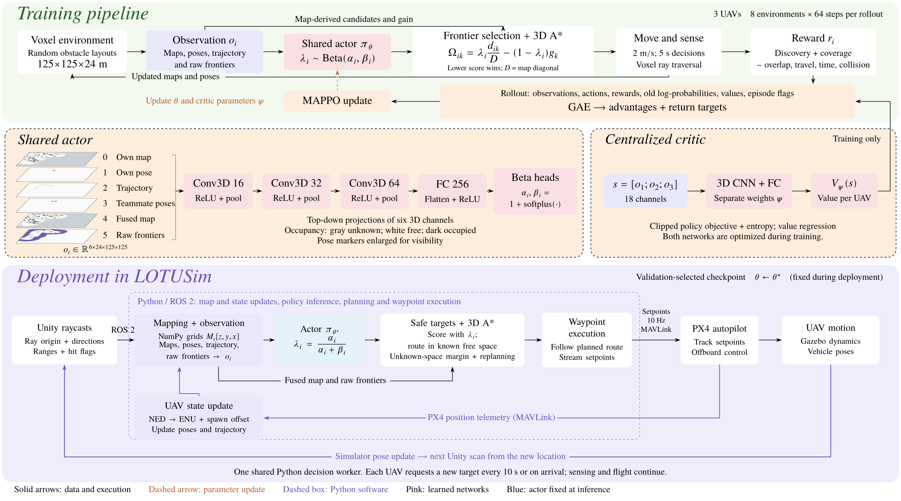

# Cooperative UAV Exploration with Multi-Agent Reinforcement Learning

**🌐 Project website: https://gechhai.github.io/lotusim-reinforcement-learning/**

[](https://gechhai.github.io/lotusim-reinforcement-learning/)
[](https://gechhai.github.io/lotusim-reinforcement-learning/#demonstrations)
[](https://irl-crossing-cnrs.github.io/projects/lotusim)

This repository holds the source of the project website. Open the website to see the demonstration video, animated mission replays, method and benchmark results.

## About the project

A shared MAPPO policy teaches a team of UAVs to balance **travel distance** against **new information** when choosing where to explore next. For each UAV, the policy chooses a distance–information weight. Frontier selection and a 3D A\* planner then turn that weight into a target and a route. The policy is trained in a lightweight 3D voxel simulator and then used inside [LOTUSim](https://irl-crossing-cnrs.github.io/projects/lotusim), where Unity provides range sensing and PX4 flies the planned waypoints.



In a fixed simulated LOTUSim minefield, three UAVs ran 10 missions per method. The learned policy reached 95% coverage in **203.0 ± 23.4 s**. The nearest-frontier baseline took 430.3 ± 50.7 s and Voronoi assignment took 436.3 ± 45.4 s. The learned policy also flew about 43% less total distance than nearest-frontier. These are simulation results only. The website gives full details and caveats.

| On the website | Link |
|---|---|
| LOTUSim demonstration video and key results | [Demonstration](https://gechhai.github.io/lotusim-reinforcement-learning/#demonstrations) |
| Abstract | [Abstract](https://gechhai.github.io/lotusim-reinforcement-learning/#abstract) |
| Training and deployment pipeline | [Method](https://gechhai.github.io/lotusim-reinforcement-learning/#method) |
| Benchmark against classical baselines | [Results](https://gechhai.github.io/lotusim-reinforcement-learning/#results) |
| Mission replays and trajectories for 3, 4 and 5 UAVs | [Larger teams](https://gechhai.github.io/lotusim-reinforcement-learning/#team-sizes) |

## Repository layout

- `site/index.html`: page content
- `site/style.css`: layout and typography
- `site/app.js`: mission replay selector (3, 4 and 5 UAVs)
- `site/assets/`: figures, demonstration video, replays and configuration files
- `.github/workflows/pages.yml`: deploys `site/` to GitHub Pages on every push to `main`

## Preview locally

```sh
python3 -m http.server 5174 --bind 127.0.0.1 --directory site
```

Then open http://127.0.0.1:5174. You don't need to install anything or run a build.

## Credits

The page is adapted from the [Academic Project Page Template](https://github.com/eliahuhorwitz/Academic-project-page-template) (commit `d38af1ccae1ce82c3404d2820c4c646afd409f81`), which is derived from [Nerfies](https://nerfies.github.io/). The template's documentation and CC BY-SA 4.0 notice are kept in `docs/template-original-readme.md`. The visual layout is inspired by [C²-Explorer](https://robotics-star.com/C2-Explorer/); none of its images, authors or results are reused. Simulator imagery is from LOTUSim-Energy. The method builds on FA-MARL (Song and Yang, ICCA 2026, DOI [10.1109/ICCA69928.2026.11618240](https://doi.org/10.1109/ICCA69928.2026.11618240)). Research data and media keep their existing rights; the template license does not relicense them.
